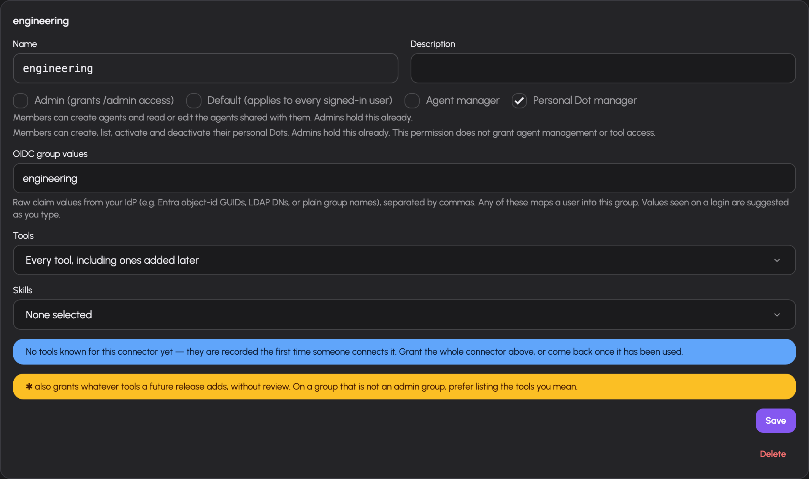
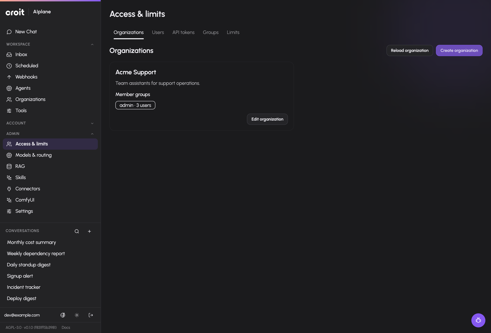
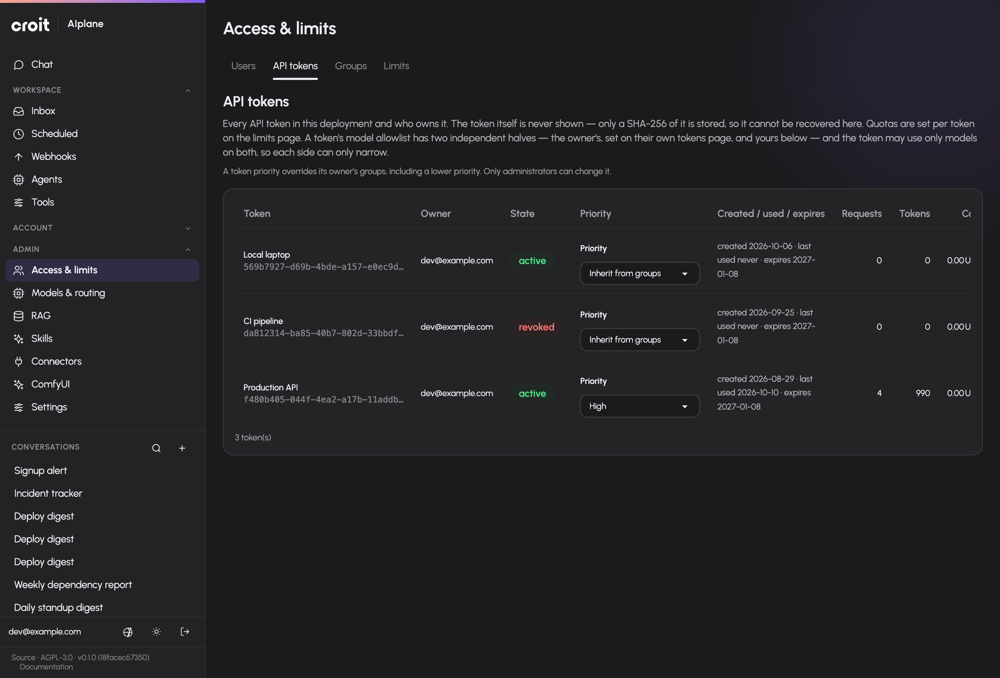

# Manage access, tokens and limits

Use **Administration → Access** to manage groups, inspect users and API tokens, and define usage limits. These administration endpoints require the `admin` role. User creation and identity authentication come from OIDC; the Users screen lists identities that AIplane knows.

## Map identity groups to AIplane permissions

Open `/admin/groups`. The page has **Groups**, **Identity**, **Tools** and **Skills** tabs.

1. Inspect **Identity** to see observed OIDC values and their current mappings.
2. Create a group from a value, or add a group in **Groups**.
3. Configure the group's name, description, OIDC values, administrator/default flags, tools and skills.
4. Save and verify the mapping in **Identity** and the effective roles in **Users**.
5. Use the **Tools** and **Skills** matrices to compare or edit grants across groups.

The matrices edit the same group grants as the group form. Tool rows include individual tools and discovered families such as an MCP connector or ComfyUI. A wildcard grants a wider set than individual entries; inspect the resulting matrix before using it. Deleting a group requires confirmation and changes the permissions resolved through that group.

In the group's form, enable **Agent manager** to let its members create agents and read or edit agents shared with them. Administrator groups already have this permission, so the form shows it as enabled and unavailable to change. This permission does not grant access to every model, connector or tool: agents still need their own resource grants, described in [agent permissions](../agent-guide/permissions.md).

Enable **Personal Dot manager** independently to let members list, create,
activate and deactivate their own personal Dots and change directed
communication consent between their own Dots. Administrators hold this
permission. Fresh groups default to disabled; enable it on an existing default
group if every authenticated user should be able to manage personal Dots.
It grants neither ordinary agent management nor additional tool access.
The saved group flag is `can_manage_dots`; live RBAC reload applies changes
immediately. Revoking it blocks lifecycle management and consent changes, but does not deactivate
Dots or stop existing runs. Current user/tool grants, active state and approval
rules continue to govern execution. See [Dots](../dots.md).

*Independent personal Dot management in the existing group form. The wildcard
tool grant shown belongs to the synthetic fixture; its existing warning remains
visible and the Dot checkbox does not add tool grants.*

Builder permission does not itself give an agent permission to use every model or tool: the agent has separate grants, documented in [agent permissions](../agent-guide/permissions.md).

Pool allowed groups, collection allowed groups, connector allowed groups, tool grants and skill grants serve different resources. A tool being listed in a permission matrix does not establish that its external service is configured or reachable.

## Organization membership and Dot limits

Organization metadata is administered through
`/api/v0/admin/organizations`, or use **Access & limits → Organizations**
(`/admin/organizations`). Select actual gateway groups as membership
sources. Existing OIDC mappings continue to resolve those groups; the
organization does not introduce a second identity roster. Each member-group
badge shows the number of locally known users currently resolved into that
group. Counts use users' latest stored OIDC claims; a default group includes
every locally known user. These counts reflect people who have signed in to
AIplane and are not a live query to the IdP directory. Empty bindings provide
no membership. Deleting a bound gateway group removes that binding; recreating
a group with the same name does not restore it.

Choose **Create organization** to open its metadata dialog. Existing cards
edit the organization's actual name, description and selected member groups.

Metadata edits require the organization's returned revision. A concurrent
metadata or binding change returns a conflict rather than overwriting the
newer choice. The administrator can repair an organization with no members.
Creator attribution does not determine ownership: deleting the creator's
account leaves the organization and its organization-owned Dots intact.

Members need **Agent manager** and a write share to configure an existing
organization Dot. A member with Agent manager can create one and receives its
initial write share. **Personal Dot manager** controls personal Dot lifecycle
independently. Membership alone exposes neither a Dot configuration nor its
principal grants. Administration retains configuration recovery access.

`dots.max_active_per_organization` defaults to four, independently of
`dots.max_active_per_user`. Each limit counts stored active Dots, including
idle ones. Deactivating a Dot frees a slot; publishing an organization Dot
does not enable execution. A current member with Write access can authorize,
explicitly select and erase that Dot’s own OAuth connection from its existing
agent editor. Personal Dot management permission is not required. Nonmember
administrator recovery grants no credential access. Organization execution,
organization-wide credentials and organization knowledge require their
remaining implementation packages. See [organization Dots](../dots-organizations.md).

## Inspect users and impersonation

Open `/admin/users` to see user identity, observed OIDC groups, resolved gateway roles and join time. Use these values to diagnose a missing permission rather than guessing which identity-provider claim was received.

If `gateway.allow_impersonation` is enabled, another user's row offers an impersonation action with confirmation. The session changes to that user's view. Use the impersonation controls in the application to return to the administrator session. The Users page shows the impersonation audit with timestamp, action, administrator and target. If the setting is disabled, the action is unavailable.

Impersonation exposes the selected user's application context. Configure this setting deliberately in [system settings](settings.md); the documentation does not change its enabled state.

## Restrict API tokens to models

Open `/admin/tokens` to inspect all tokens, their owner, state, dates, request/token counts, cost and model scope. Personal token creation is in the user's Settings → Tokens screen.

1. Find the token by its name and owner.
2. Edit its model restriction in the token row.
3. Enable restriction and select the allowed model names, or disable restriction to remove that token-specific list.
4. Save and inspect the updated scope.

The model picker groups models by kind, including a **Reranking** group for the models `POST /v1/rerank` serves. A system principal can also be granted a rerank model through `POST /api/v0/system-principals/{id}/grants` with kind `model`; the agent setup pickers offer chat, transcription and speech models only.

A token restriction narrows model access. Removing it does not grant rights beyond the owner's existing access. Usage columns depend on usage accounting. The list does not recover plaintext bearer secrets.

## Set request, token or cost limits

Open `/admin/limits`. Ensure `limits.enabled` is on in [system settings](settings.md).

1. Choose the subject: global, group/role, user, token or system principal/agent.
2. Select the concrete subject when the scope is not global.
3. Choose all models, a particular model, or a model family with a trailing `*` (e.g. `claude-*`).
4. Choose requests, tokens or cost, then hour, day, week or month.
5. Enter the limit and save. Leave **Overall ceiling** off unless the rule must cap additionally (see below).
6. Check the rule table and the user's limit display on **Usage**. Use Edit to change a rule or Delete with confirmation to remove it.

Overlapping rules resolve most-specific-first, per dimension (requests, tokens, cost) and called model: your own rule beats a role's, which beats the global default; at the same subject level an exact model beats a `prefix-*` family, which beats all-models. The window is not part of specificity: the winning level applies with every window set on it and replaces every window of the levels beneath, so a user's 75 USD per day replaces a 25 USD per week default for that user. Spend counts only against the rule that won for the model it was made on: with 75 USD for a user and 250 USD for that user on `claude-*`, Claude spend draws on the 250 and leaves the 75 for every other model.

A rule marked as overall ceiling takes part in that resolution like any other and is, in addition, always checked against everything it covers. Use it for a real total budget: 100 USD as overall ceiling with 75 USD for each of two models lets either model reach 75 USD, and both together never more than 100. Token rules stay a second, additional ceiling next to the owner's budget and can only narrow it. Because a more specific level replaces every window of the levels beneath, a short-window guard such as 60 requests per hour for everybody must be marked as overall ceiling to survive a user's or group's own monthly rule. Several groups with rules in different windows at the same level all apply. Rules from before the ceiling checkbox existed stay overall ceilings until edited, so a former default still caps everyone until it is switched to an override. The **Usage** page lists only the rules that can still apply to the user; a rule replaced by a more specific one is left out.

A cost limit never refuses a model whose price is not above zero, unpriced models included: such a call settles to 0 and cannot move the budget, so it stays usable after the budget is spent. Request and token limits apply to it as usual. Agent budgets are checked per visitor message before a model is chosen, so they keep counting cost against every model.

Costs use the configured currency and model pricing. Missing prices make a cost-based policy incomplete; verify the unpriced-model warning before using monetary totals to judge consumption. A pool's `enforce_limits` declaration also affects enforcement and belongs in the routing review: a pool with it off is exempt, so its calls consume no budget and are not refused once a budget is spent, by user, group, global and token rules alike. Every model-routed `/v1` endpoint checks limits against the model it resolved, `/v1/responses`, transcription and image editing included; an automatic route also checks its selector model right before asking it ([automatic routing](../automatic-routing.md#limits)). Steering a running chat answer is checked on that turn's model, so it honours an exempt pool like sending a message does. The chat's voice input and read-aloud (`/api/v0/transcriptions`, `/api/v0/speech`) are checked like a message: against the user's own, group and global rules on the transcription or speech model they resolve to, before any audio is processed or a backend slot is taken, and refused with the same `429 rate_limited` and a `Retry-After` until the breached window moves on (a browser session carries no token, so token rules do not apply). A sentence read aloud from the gateway's speech cache makes no upstream call and records no usage, so limits do not refuse it; access does: the cache is shared, so it answers only a user whose groups reach the speech model. If the user's account cannot be read, a voice call is refused with `500` rather than run without their groups. A chat request over its budget is refused before the [content guard](settings.md#access-and-content-guard) is asked, so it costs no guard inference.

## Read usage correctly

Open `/usage`. Available time presets are today, last 24 hours, this week, last week, this month and last month. Filter by source (API, chat, scheduled actions or agents), backend and API token. Administrators can view all users or their own scope; the server enforces access to all-user data.

The page shows summary metrics and breakdowns by backend, source, model and token, plus a user breakdown for the all-user scope. Self scope can display applicable limits. An unpriced-model warning means cost totals do not cover every model's usage. Disabled accounting is explicitly shown; it is not a zero-use result. Retention controls how far recorded history extends.

## Troubleshooting

| Symptom | Check |
|---|---|
| Admin page returns forbidden | Effective `admin` role shown for the signed-in identity |
| Group does not match | Actual observed OIDC values, group mapping and effective roles |
| Dots management unavailable | `can_manage_dots` on a resolved group |
| Builder unavailable | `can_manage_agents` on a resolved group |
| Token cannot request a model | Token scope and owner access to the model's pool |
| Limit has no effect | `limits.enabled`, subject/model match and pool `enforce_limits`; a more specific override for that user or model replaces it in every window; a cost limit never refuses a model priced at zero |
| Cost looks too low | Unpriced models, configured prices, filters and retention |
| Impersonation action absent | `gateway.allow_impersonation`; own row cannot impersonate itself |

## Prioritize chat and API requests

A failed token priority save restores the previous selection and displays an error without retaining an earlier success message.

Enable prioritization in [Gateway settings](settings.md), then choose Low, Medium or High on an application's token in `/admin/tokens`. The token selector saves immediately. **Inherit from groups** removes its override. In `/admin/groups`, a group can inherit the system default or choose Low, Medium or High; save the group form to apply. The highest explicit priority of the user’s groups wins. An explicit token setting overrides it, including a lower priority for background integrations. Token owners can set priority during creation or through the Priority tile under Settings → Tokens, up to their inherited user priority. Administrators can set any priority. Priority does not grant model access or bypass limits. See [Request priority](../request-priority.md) for ordering, backend configuration and timeout behavior.
