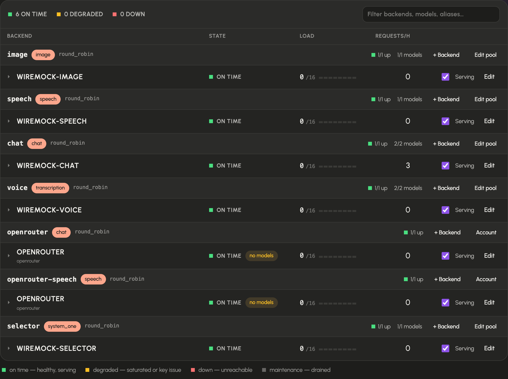
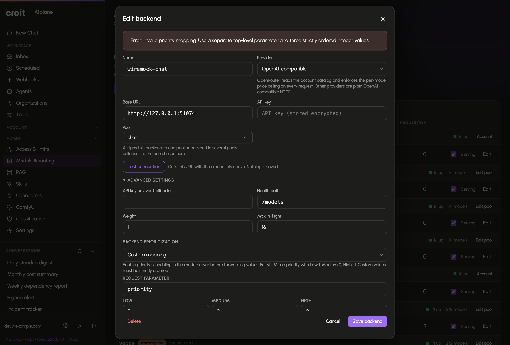

# Connect models and control routing

An **upstream backend** is a model server or provider endpoint. A **pool** groups backends for a purpose such as chat, embeddings, reranking, transcription or OCR. The **model catalog** is the set of models and aliases exposed by that topology. Configure these before selecting models for chat, agents or optional features.

You need a signed-in account with [administrator rights](access.md). Open **Administration → Models and routing** (`/admin/models`), which opens on **Upstreams**. Its tabs are **Upstreams**, **OpenRouter**, **Catalog**, **Defaults**, **Fallbacks** and **Automatic routing**. `/admin/upstreams` also opens the upstream manager.

The **Upstreams** tab is one board: each pool is a band, each backend a row inside it. A row's summary carries the state lamp, in-flight load against the configured maximum, requests in the last hour and the serving switch; open the row (the name is the disclosure) for a sentence describing its state, its endpoint, key source, advertised models, aliases and traffic history. A pool band whose configuration cannot work names the problem at the top of the band, and a backend that belongs to no pool appears in a trailing **Unassigned** band.

The board's search narrows rows by backend name, endpoint, advertised model, alias or pool. The summary lamps double as filters: clicking **down** keeps only the failing rows, and a search plus a lamp stack to "the red rows serving qwen". **Clear** returns to the whole board, and a filter that matches nothing says so instead of showing an empty page. The summary counts each backend once, at its worst state across the pools it serves — the rows are per pool, so a backend in several pools appears in several bands but counts once.


## Add a backend and pool



1. In **Upstreams**, add a pool with **+ Pool**. Choose its name, kind and selection strategy. Set allowed groups to match the actual provider arrangement. Backend membership, explicit models, offline fallback and usage-limit enforcement are in the same editor, which also carries **Delete**.
2. Add a backend with **+ Backend** at the top of the board, or with **+ Backend** on a pool band to pre-select that pool; an empty band offers the same button. Enter a unique name, its API base URL, its pool and the API key. That is the whole normal case; everything else sits under **Advanced settings**.
3. Use **Test connection** before saving. Read which credential source was used, the HTTP result and the discovered models. A connection test does not save anything.
4. Under **Advanced settings**, set the health path, request weight, maximum in-flight requests, an environment-variable key fallback, explicit models when the upstream cannot advertise them, aliases when clients need stable model names, extra headers and image-editing support.
5. Save the editor. The topology applies to the running gateway immediately — there is no apply step, and the board confirms the save with a short **Saved — live now.** line.
6. Confirm that the backend's row reports on time and that its models appear in **Catalog**. A drained or unreachable backend keeps its row and its known models, so the board still shows what is wrong.

To use OpenRouter, choose **+ Add OpenRouter** on the board or open the **OpenRouter** tab, which offers the same action when no account is connected: enter one key and keep the base URL `https://openrouter.ai/api/v1`. The tab is the one place that manages the account. Its rows are the kinds the account serves; switch a kind on or off, and open a kind to select models with the checkboxes or **Select all**, filter and sort by price, then give each one an input and output ceiling in USD per 1M tokens and a provider strategy. A model with no provider under both ceilings is not offered. Open a model's row to see every provider that serves it — input, output and cache-read prices per 1M, context, throughput, latency and uptime — each marked against the ceilings in the row; **Use the cheapest** fills both ceilings from the cheapest provider, and **Compare on OpenRouter** opens the full public table. A selected model whose providers have not been read yet says **price not checked** instead of claiming it is over the ceiling; a cleared ceiling says **ceiling missing**. Each kind's selection is the model list of its own `openrouter-<kind>` pool, so one OpenRouter backend serves chat, embeddings, speech, transcription, image, rerank and System One with different lists; the pool's board band links to the tab instead of offering a pool editor. The key is replaced in the same tab, and unsaved selection changes are confirmed before a kind is disabled or the page is left. For a speech pool the voice menu follows the selection automatically: it is the union of the selected TTS models' `supported_voices`, so there is no voice list to maintain by hand. See [upstreams](../upstreams.md#openrouter).

The saved topology and the running topology are the same thing: every save and every delete reloads the running registry and re-arms the health probes in that request. Live status updates show health, authentication failures, in-flight requests and advertised models, and a status change from another administrator reaches every open board.

### Backend fields

The editor keeps the connection fields in front — name, base URL, API key and pool — and the fields below under **Advanced settings**.

| Field | Why configure it? |
|---|---|
| Base URL | Address of the upstream API, including its API prefix where required |
| API key / environment variable | Authentication for that upstream; a stored key is not displayed back as plaintext — only a head/tail fingerprint where the key is long enough for one. Leave the field empty to keep the stored key, or tick **Remove the stored key** to delete it — the way to move a backend onto an environment variable or retire a leaked key |
| Health path | Endpoint used to check availability; the new-backend form proposes `/models` |
| Weight | Relative weighting used by strategies that consider weight |
| Maximum in-flight | Concurrent requests admitted to this backend; the form proposes 16 |
| Models | Explicit advertised model names |
| Aliases | Stable public name, optionally mapped to an upstream model using `alias=target` |
| Image editing support | Declares whether an image-generation backend can perform editing |

The connection test distinguishes authentication failure, timeout, unreachable server, other HTTP errors and a reachable endpoint that advertises no models. Fix the reported cause before applying. An environment-variable name is useful only when that variable is set in the running AIplane process.

### Pool fields

Choose the pool's purpose from the kinds offered by the server. The editor configures backend membership, explicit pool models, allowed groups, offline fallback, and whether usage limits apply; **Delete** sits in its footer and removes only the pool — its backends stay and become unassigned. A pool's explicit model list accepts comma-separated names and can be pinned by clicking the chips of the models its own backends advertise. A pool's classification level is an assignment in the database, see [data classification](settings.md#data-classification). Speech pools have language-to-voice mappings and an offered-voices list.

| Selection strategy | Behavior |
|---|---|
| `least_inflight` | Chooses based on current in-flight load; the new-pool form's default |
| `round_robin` | Distributes requests in rotation |
| `prefix_affinity` | Keeps matching request prefixes on the same replica where practical, while avoiding overloaded replicas; requests with no usable prefix fall back to least-in-flight selection |

The **System One** pool kind serves models for TypeSafe System One requests, including data classification checks and automatic-route selection. It is separate from the chat pool that receives the user's request; review both destinations' provider arrangements when configuring those features.

The **rerank** pool kind serves cross-encoder models that score passages against a query. Knowledge search uses it, when one is configured, to reorder the candidates it found ([knowledge collections](knowledge.md)). API clients call the same models through `POST /v1/rerank`, and `/v1/models` lists them. A rerank pool's allowed groups restrict which people's tokens may call or list its models; a pool without allowed groups is open to every token with default pool access. Knowledge search ignores those groups, because it calls the reranker as the gateway itself. `POST /v1/rerank` relays the request in the backend's own format; see the [HTTP API reference](../reference/api.md#reranking).

Prefix affinity is useful for self-hosted replicas with separate prompt-prefix caches. It is separate from an automatic route's session affinity: one chooses a backend replica, the other retains a selected model target.

A pool's **classification level** is the most sensitive data its models are cleared for; it is an operator declaration, and AIplane does not inspect contracts, verify data residency or certify compliance. A pool without a level is at the lowest level. Levels do not grant access; allowed groups govern pool access, together with [group permissions](access.md). Review an offline fallback's availability, level and user access before relying on it.

Backend and pool names can be changed through their editors. Deletion removes the configured resource and applies immediately; the pool editor and the backend editor each ask for confirmation. Do not overwrite another resource's name without reviewing the editor's explicit overwrite warning.

Use a row's serving switch to drain or re-enable a backend. The switch changes admission immediately; inspect the row's in-flight count when draining for maintenance. The **Fallbacks** tab sets one substitute per pool kind for unknown-model requests. Changing that substitute is live immediately and is distinct from a pool's offline fallback or a feature's default model.

### Fallbacks and temporary outages

The three fallback choices answer different problems:

| Setting | Used when | Example |
|---|---|---|
| Unknown-model fallback for a pool kind | A request names a model that is not known to that kind | A client still asks for a model name that was removed or renamed |
| Offline fallback on a pool | The requested model is known, but no healthy backend in that pool can serve it | All replicas of a known model are restarting |
| Feature default | A feature needs a model and the caller did not select one | The configured default transcription model |

For a known model, AIplane skips unhealthy or drained backends and routes to a healthy sibling when one serves it. If no backend is available, it can hold the request and retry routing for the configured upstream-wait budget; the current default is 120 seconds. A backend connection failure or an upstream 502, 503 or 504 can also be retried against another eligible replica before any response has been sent. When the wait expires, API clients receive a retryable capacity error with `Retry-After`. An unknown model is not held waiting for capacity. An offline fallback can route around a complete pool outage immediately, so choose one only when its data-handling coverage and caller access are appropriate.

## Configure a model

1. Open **Catalog**. Search by model name or use the chat, other, aliases or configured filter. A model row's **served by** line names the pool and the backends carrying it right now and opens **Upstreams** filtered to that model; the board's model chips link the other way, into the catalog. A model nothing serves has no such line, which is what the **inactive** filter is for.
2. Open the model editor (`/admin/models/edit`).
3. Set input/output prices in the unit shown for that model kind. Configure prices before treating monetary usage totals as complete. With a per-token price, embedding and rerank calls are charged at the input price; when a backend reports only a total token count, those tokens count as input. A rerank backend that reports no token usage (Text Embeddings Inference) or reports search units instead (Cohere) records its calls with no tokens and no cost; see [reranking](../reference/api.md#reranking).
4. Optionally set the **description**: the one-line subtext the chat picker shows under the model or alias. It is limited to 240 characters and is searchable in the picker.
5. For a chat model, verify its context window, reasoning format and capabilities against the upstream's actual configuration.
6. Save. Return to the catalog and inspect the configured values.

Chat overrides include reasoning styles `none`, `qwen`, `openai`, `glm`, `anthropic` and `ollama`; token budgets or effort values for the low, medium, high and xhigh levels (off turns thinking off and has nothing to tune); vision, tools, structured output, audio input, PDF input and parallel tools; and a fallback model for vision. Capability fields distinguish **unknown**, **enabled** and **disabled**. Unknown is not proof of support. The vision fallback describes images returned by tools only when vision is explicitly **Disabled**; Unknown and Enabled leave the image unchanged. If describing an image fails, AIplane keeps the original image part. Setting tools to **disabled** keeps AIplane from offering the model any tools: the chat's requests carry no `tools` field, in every round of a turn.

Token budgets are offered only where they are enforced: always for Anthropic-style models, and for a Qwen-style model only when every backend serving it caps thinking per request — vLLM with its reasoning parser, or SGLang started with `--enable-strict-thinking` (see [thinking budgets](../upstreams.md#thinking-budgets)). Elsewhere a budget would be dropped without an error, so the fields are hidden. A budget must be at least 1024 tokens: an open-weight model cut off sooner tends to carry on thinking in its visible answer.

The context-window hint warns when an override exceeds the detected upstream window: AIplane cannot enlarge the upstream's actual context capacity. The TOML defaults field accepts model request defaults: flat keys are the sampling parameters (`temperature`, `top_p`, `max_tokens`, `stop`, …), and one level of table holds a provider extension parameter as a whole. The table is inserted into the request only when the client did not send that top-level key — a client value wins, there is no deep merge. OpenRouter's provider routing is the usual case:

```toml
[provider]
only = ["together"]
allow_fallbacks = false
```

sends the request to the Together serving of the model and never falls back to another provider. **Clear overrides** removes a chat model's overrides; non-chat model editors expose pricing only.

## Set feature defaults

Open **Defaults** and choose the chat, transcription, speech, image or embedding default. The selection saves immediately. Clearing a selection removes the explicit feature default. Defaults choose from the existing model catalog; they do not add backends or grant access. If a feature has no suitable available model, fix its upstream pool before changing the default.

## Create an automatic route

Use an automatic route when clients should request a stable alias and AIplane should choose among known chat models for each request.

1. Open **Automatic routing** and add a route. The form requires an available selector and at least two candidate models.
2. Set the alias, selector model and quality/balanced/cost objective. The route's **description** is the line the chat picker shows under the alias; candidate descriptions inform selection.
3. Give every candidate a unique key, a real model target and a description of its intended workload. These descriptions inform selection.
4. Choose a fallback from the candidates. Set confidence threshold and selector timeout.
5. Begin with **Shadow** rollout. Save and send representative requests to the alias. Inspect recent decisions.
6. Select **Active** when those decisions meet your requirements.

The editor proposes confidence `0.7`, timeout `1500 ms`, shadow rollout, disabled session affinity and a one-hour affinity lifetime. Its timeout range is 100–30000 ms; affinity lifetime is 60–604800 seconds. Shadow records the selector's choice while using the fallback target. Active routing can select a candidate; low confidence or selector failure uses the fallback.

On the `/v1` endpoints, usage limits apply to the selector model right before it is asked: a caller over budget on an enforced selector pool gets `429` without a selector call, while a selector on an exempt pool is still asked. A session-affinity hit asks no selector and is not checked on it. The target's limits are checked after selection, so a target refused by its own rule costs the selector call. See [automatic routing](../automatic-routing.md#limits).

The selector receives request content. Treat its provider as another processor of that content. Session affinity can retain a choice across related requests; it has an explicit lifetime. The decision table identifies route version, effective target, confidence, latency and outcomes such as selection, shadow, low confidence, selector error or affinity. Edit existing routes to revise their policy; delete a route only after checking its callers.

## Troubleshooting

| Symptom | Check |
|---|---|
| Saved backend is not used | The row's state lamp, the pool band's problem strip, advertised models and pool kind |
| Authentication badge/error | Test's credential source, stored key and process environment |
| No models | Upstream model discovery, explicit model names, pool kind and health |
| Model missing for a user | Pool allowed groups and token model restrictions |
| Automatic route cannot be added | Available selector and at least two eligible candidate models |
| Route repeatedly uses fallback | Decision reason, confidence, selector timeout and candidate availability |
| Cost appears incomplete | Input/output price overrides and the Usage unpriced-model warning |

## Backend priority forwarding

When saving a backend fails, the error receives keyboard focus and scrolls into view. Priority validation messages follow the selected UI language.



The backend editor offers **Automatic**, **Gateway only**, and **Custom mapping**. Automatic requires reported active scheduling, supported policy and integer ordering; otherwise the editor reports that forwarding is unreported. Gateway only uses AIplane’s queue. Custom mapping specifies a top-level request parameter and ordered Low/Medium/High integer values, overriding detection. For vLLM enable `--scheduling-policy priority` and map `priority` to 1/0/-1. For SGLang enable `--enable-priority-scheduling` with `fcfs` or `lof`; its direction can be reported by `/server_info`. Save; the change applies to the running gateway immediately. Software detection alone does not enable forwarding. Unsupported backends keep the same three gateway priority levels. See [Request priority](../request-priority.md).
