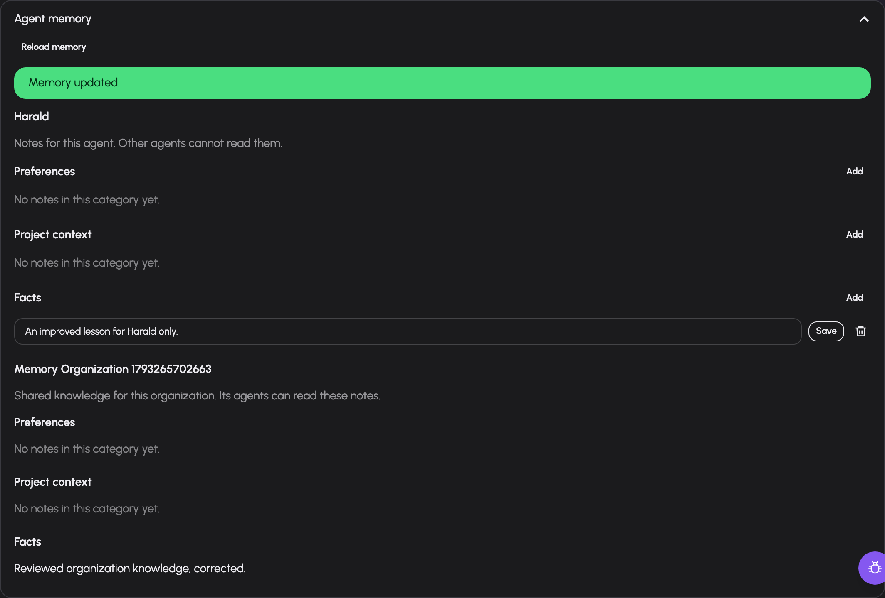

# Grant resources and share agent access

An agent's **resource grants** control what its principal may use. Its **shares** control which people may manage it or respond to waiting work. Configuring one does not configure the other.

You need agent-management permission and write access to change grants or shares. The server verifies resource grant authority when a grant is made; a manager may grant only resources they hold. A new agent starts with no grants.

## Grant the resources an agent uses

1. Open `/agents/<id>` → **Setup** → advanced → **Grants**.
2. Choose a resource kind and select/enter its reference from the available resource catalog.
3. Add the grant. Inspect the resulting kind/reference/granted-by row.
4. In Setup, select that resource in the spec where the task needs it.
5. Save and test. Publish validation checks required grants for the configured resources.

The grant kinds are `model`, `tool`, `connector`, `skill` and `rag_collection`, as offered by the agent resource catalog. Use real catalog references. Model choice reuses the same models, aliases and automatic routes as the rest of AIplane; it is not a separate pool/tier model selection.

Granting a tool permits its use by the principal; selecting it in `main.tools` makes it part of that agent's intended behavior. A knowledge collection grant concerns the corpus; the agent also needs a suitable retrieval tool. A skill grant concerns the installed bundle; the agent selects it in `main.skills`.

Revoke removes the selected grant. Grants are not versioned with the spec: changing a live version or restoring an older one still uses today's grants. Missing grants can therefore affect a previously working published version.

## Configure tool approval policy

Open advanced **Edit** and expand the selected tool's settings. Set `permission` to `always_allow` or `always_ask`, or leave it unset for default policy. Configure `approval_timeout` through the supported spec editor when a task needs an explicit deadline.

Personal and organization agents ask for approval by default unless the tool
explicitly declares itself read-only. Missing safety annotations therefore
require approval. Explicit tool and action rules still apply; a connector's
own requirement to ask for approval remains a minimum requirement.

`always_ask` creates a persisted turn suspension before the permitted tool call executes. The waiting card includes the tool and its arguments/preview where available. Approving one call is separate from changing the agent's permanent grant. [Inbox handling](run-observe.md#answer-waiting-work) explains who can respond and what expiry means.

Bound tool arguments come from configured constants/state rather than letting the model freely replace those inputs. Use a trusted state slot for an input that depends on verified identity. Test both accepted and refused paths before publishing.

## Share with managers or responders

1. Open **Settings → Sharing** (`/agents/<id>?tab=settings&sub=sharing`).
2. Choose user or group and the access level.
3. Search for the actual subject and select a returned result. Search begins from two characters; the form does not expose the whole user roster.
4. Add. Inspect the table, then change access or revoke a share when needed.

| Access | Intended use |
|---|---|
| `read` | Inspect agent configuration and its conversations |
| `write` | Manage agent configuration and access |
| `respond` | Answer authorized waiting inbox items |

Read and write recipients must be agent managers because those rights expose the spec and visitor conversations. Respond access can be granted to users/groups without builder permission. The server rejects a change that would remove the final write share. An error states the missing requirement; changing the browser form cannot bypass it.

Share access is sensitive because it can expose visitor conversation content. Choose the narrow access needed for a responder, and review the existing table after each change.

## Organization agent configuration

An organization agent uses these same grants, shares and spec controls. Its
persisted organization owner supplies an additional membership boundary:
current membership and an appropriate share are both required. Read and write
still require agent-management permission. Respond access supplies authorized
Inbox standing without exposing the configuration. Administration retains
configuration recovery rights.

Organization share searches suggest eligible current members and the
organization's bound groups. Results are capped at eight users and eight
groups. A broad search can reach its bounded candidate budget before finding
a member; when `truncated` is true, narrow the query. Absence from that partial
result does not establish absence of an eligible account.

The resource inventory describes configuration grants. Organization connector
tool inventory and direct Connector grants require an explicitly selected,
connected own-principal OAuth credential with current binding, credential and
catalogue generations, plus the writer's existing resource grant ceiling. Current member writers can manage the
Agent’s own OAuth credential through the connection panel in **Setup**.
Authorization and explicit selection are separate actions. The server repeats
current membership, Write access and catalogue checks before OAuth exchange
and credential save. Read/respond shares and nonmember administrator recovery
provide no credential access. An authorized writer can erase retained local
credentials even when the connector is unavailable. Active organization agents
with enabled principals and explicit grants can run saved drafts or published versions in private
Test chat for current member writers. Every response and new message checks
current access; a resumed run retains its original source, version, authored snapshot and grant ceiling.
Private published decisions appear only in the current member-writer Inbox.
Automated and external organization callers remain unavailable. Configuration
never gives the agent an employee's account. See [organization
Agents](../agents-organizations.md) for the implementation boundary.

## Organization agent memory

Open the agent's **Setup → Agent memory** panel. Current members with Read access
can inspect the agent's own notes and knowledge shared with all agents of that
organization. Respond-only access and administrator recovery without membership
do not expose notes. Write access enables adding, editing and deleting the
Agent's notes. Editing shared organization knowledge additionally requires
current gateway administration rights and membership.

Each section uses the actual agent or organization name. The shared section
explains that other agents in that organization can read it. Select Add under
Preferences, Project context or Facts; edit existing text and select Save, or
confirm Delete. New or edited notes must fit within 2,000 UTF-8 bytes. Some
characters use multiple bytes; shorten a refused note and save again.

*The current member writer can edit Harald's own lesson. Shared organization
knowledge remains read-only for this writer. This example uses synthetic demo
data.*

Use Reload memory to obtain current notes and rights. If access has been
removed, reloading clears previously displayed notes. Runtime `recall` and
standing context include the agent's own notes and shared organization knowledge
only when its actual Recall grant and tool selection permit them. Memory
mutations retain the agent's tool rules and approvals and affect only its own
notes. Employee preferences and personal memory are excluded. Notes persist
across private draft conversations; automatic memory curation remains planned.

## Troubleshooting

| Symptom | Check |
|---|---|
| Grant refused | Manager's own rights to that resource and agent write access |
| Spec lists a tool but run cannot use it | Real tool ID, principal grant and tool availability |
| Older live version fails after rollback | Current grants; rollback does not restore them |
| Share subject not offered | Search length, actual user/group and server eligibility |
| Read/write share refused | Recipient's `can_manage_agents` permission |
| Respond-only person cannot open builder | Expected separation of responder and manager access |
| Cannot revoke writer | At least one write share must remain |
