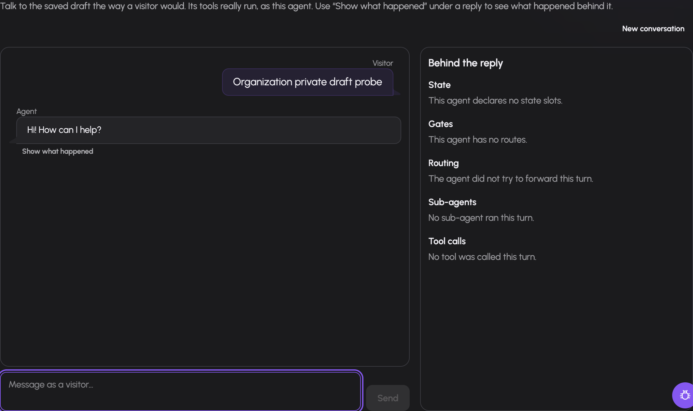
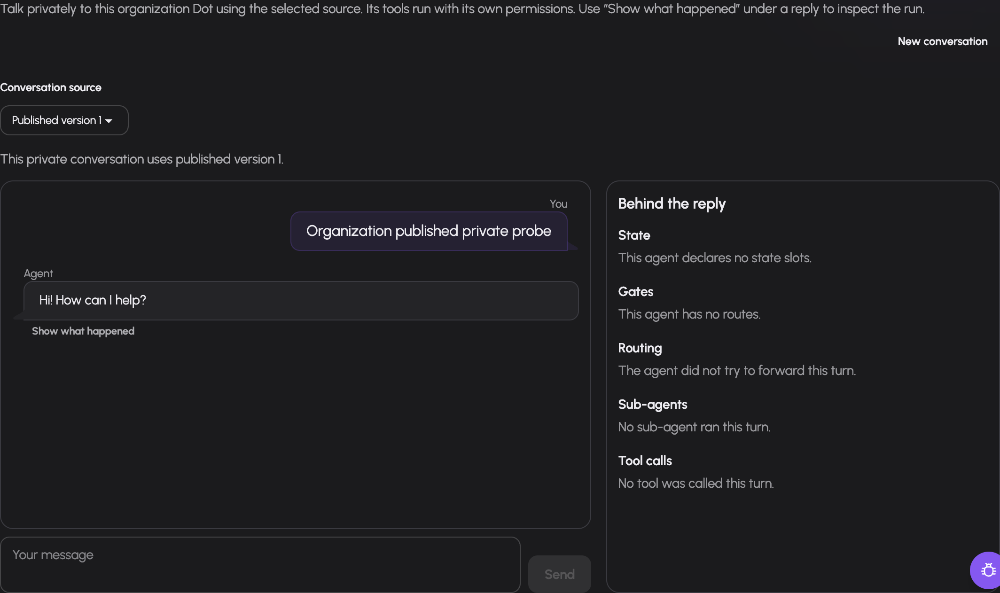

# Test and publish an agent

Testing examines the saved draft or a selected published snapshot. Publication creates a numbered immutable snapshot and makes it live. Use testing to verify routes, permissions and actual answers before a visitor depends on them.

You need agent-management permission and access to the agent; editing test cases or publishing requires write access. The model, tools, connectors and collections used by a test must be available to its principal.

Organization Dots use the existing draft editor and publication mechanisms.
An active Dot with an enabled principal can run its saved draft or published version in **Try it →
Test chat** when the initiating member has current Write access. Its model and
tools run under the Dot's explicit principal grants, without the member's
credentials or personal context. With Recall selected and granted, its
bounded memory context includes its own notes and shared organization knowledge;
its memory tools can change only its own notes. Pauses can be answered in the
private chat. Published private approvals, human answers and secure input also
appear in the Inbox for current member writers; draft pauses remain inline.
Current membership and Write access are checked again when responding.

Organization automated test suites, delegation, webhooks and external
channels are unavailable. Organization scheduled work uses explicit published
versions; see [schedules and inbox](../guide/automation-and-inbox.md#schedule-work-for-an-organization-dot). Publishing a snapshot does
not enable those callers. Organization membership also narrows share access;
see [permissions](permissions.md#organization-dot-configuration).

## Try the saved draft

1. Open `/agents/<id>?tab=try&sub=test`.
2. Save pending draft changes when prompted.
3. Start a conversation and send representative visitor messages.
4. Inspect the streamed answer and stopped-turn debug view.
5. Answer any waiting approval, secure input or human-handoff card using the offered controls.
6. Use New conversation when the next scenario requires clean state.

*A current organization member with Write access tests Harald's saved draft.
The conversation runs as Harald's principal and remains separate from personal
chat history. This example uses synthetic demo data.*

The test chat executes the agent's tools as its actual principal. It is not a dry-run tool simulator: take real external writes into account when choosing test scenarios. The output filter may replace an answer after the turn finishes; the refreshed transcript shows what the visitor would receive.

Debug is manager-visible and helps inspect state, gates and routes. A selected earlier turn can be inspected separately from the latest one. A paused turn needs its answer or expiry before it can finish; sending another message is not approval of a waiting tool.

## Choose an organization conversation source

In **Try it → Test chat**, select **Saved draft** or the actual **Published
version**. Publication must exist before the published option is offered.
The saved draft is the initial selection; its unsaved-change prompt applies
only to draft execution. The source and captured published number are shown
when the conversation starts.

A published conversation keeps that number across later publication or
rollback. Continue the conversation to use the original version. Select another
source or choose **New conversation** to start fresh. Source changes and reset
are disabled while sending, running or answering a decision. Reset stops viewing
the conversation; it does not cancel an existing server-side pause. Use **Stop**
to cancel the exact running or waiting turn. Stop requires current Write access
and, for an organization Dot, current membership; it remains available after
the Dot is deactivated or its execution grants change.

*A current organization member with Write access uses published version 1.
Later publication keeps this conversation on its captured version. This example
uses synthetic demo data.*

## Inspect an organization scheduled conversation

The Dot's **Scheduled actions** link opens its scoped automation list. A schedule card
or run-history link opens Test chat with the recorded `test_session`. The
conversation remains private to current member writers. Test chat obtains its
source and published number from the actual history before offering further
messages; it does not infer a draft source from a missing response. A schedule
fire uses its selected published snapshot and a fresh conversation. Later
publication retains the recorded conversation's version.

Use the waiting card or Inbox to answer a pending request, or **Stop** to cancel
that exact turn. Pausing the schedule only prevents later fires. Changes to the
schedule's execution configuration invalidate the earlier configuration's
pending dispatch authority. Stop remains available for structural cleanup even
when that authority is unavailable.

## Add repeatable test cases

For ordinary agents, open **Try it → Tests** (`?tab=try&sub=tests`).
Organization Dots provide private draft or published Test chat; automated suites are unavailable.

1. Add a named case.
2. Write its script of visitor messages. Add trusted state writes where the scenario explicitly requires that writer.
3. Define deterministic expectations for the result.
4. Optionally add a quality rubric.
5. Save. Choose the saved draft or a published version and run the suite.
6. Inspect each case report and history; edit or delete cases as the real requirements change.

Each case runs in an isolated test conversation. The editor can express expectations for gate openness and missing state, selected route, sub-agent outcomes, tool outcomes, bound values, answer contains/does-not-contain text, output-filter result and whether the run finished.

Reports separate **Goal**, **Plan** and **Action**. The optional rubric is judged by a model and displayed separately; it does not change deterministic pass/fail. A green result proves the tested scripts and expectations, not every possible visitor conversation.

## Require passing tests before publication

Set `publish.require_passing_tests` when publication must be gated by the suite. The advanced Settings form exposes this checkbox.

The publication guard requires a nonempty suite and the newest draft run to pass for the exact current draft and current suite. Changing either makes that prior run stale. A run against an older published version does not satisfy a draft publication gate. Rerun the suite after the final change.

## Publish a version

1. Save the final draft and resolve blocking issues.
2. Run its test suite if required by policy.
3. Use Publish in the agent header or **Settings → Versions** (`?tab=settings&sub=versions`).
4. Confirm the numbered version is marked live.
5. Test the intended caller, such as the website widget, against the published version.

Publication validates the spec at the publish stage, including required resource references and grants. The Versions pane lists blocking issues with spec paths. Draft validation deliberately permits some incomplete setup; a saved draft therefore need not be publishable.

The version list records publisher/time and expandable snapshot JSON. To return production callers to an older snapshot, use its Make live action with confirmation. This changes the live pointer; it does not restore old grants, connectors or external data. Verify those current dependencies after changing the live version.

## Troubleshooting

| Symptom | Check |
|---|---|
| Test uses old instructions | Saved draft and pending changes |
| Test pauses indefinitely | Waiting card, answer rights and expiry |
| Test produced an external side effect | Tests use real granted tools |
| Rubric passed but suite failed | Deterministic Goal/Plan/Action failures; rubric is separate |
| Passing suite does not unlock Publish | Draft/suite changed, latest draft run stale, or empty suite |
| Published agent behaves differently | Live snapshot, current grants and caller state |
| Older snapshot fails after Make live | Today's grants and dependencies |
