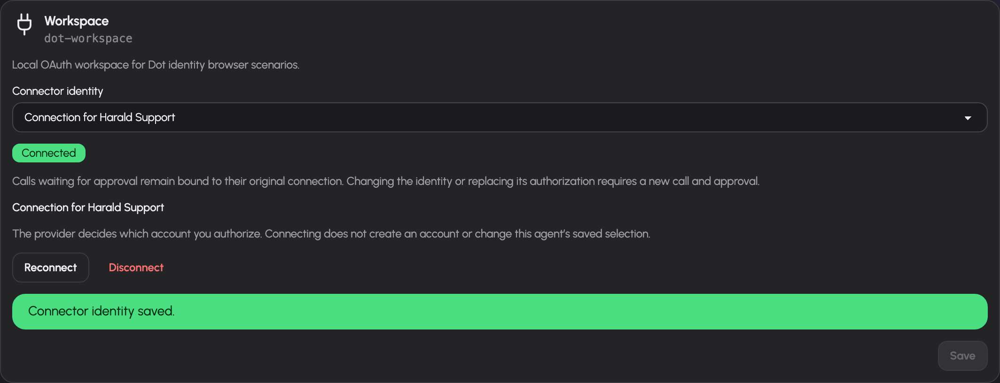

# Agent connector identities and organization ownership

## Status

Personal agents can select their user's OAuth connection or a separately authorized connection owned by their agent principal. Storage, runtime selection, JSON endpoints and the web controls extend the existing MCP authorization mechanism. The real Chrome scenario exercises authorization, explicit selection, actual tool discovery and isolated disconnect. Organization ownership, group-derived membership and configuration are implemented. Current organization member writers can authorize, explicitly select and disconnect their agent principal’s own OAuth credential through the same connection routes. Active organization agents can use an explicitly selected own connection in a private saved-draft test chat; published and automated callers remain unavailable. Connecting an account does not provision a provider account.

## Verified source baseline

| Source | Current mechanism and constraint |
|---|---|
| `aiplane-core/src/server/db/mcp_connections.rs`; migration `0082_personal_dot_sessions.sql` | One connection per typed user/principal owner and connector. Access/refresh/DCR secrets are ciphertext plus nonce. Pending OAuth binds the initiating user, exact reserved connection, target owner, generation and expiry. `user_mcp.rs` retains existing tool preferences and API-token policy. |
| `aiplane-core/src/server/auth/mcp_oauth.rs` | OAuth discovery, PKCE, dynamic client registration, authorization, code exchange and refresh. Token results do not provide a general verified provider-account identity. |
| `aiplane-api/src/pages/integrations.rs` | Reused connect and shared `/integrations/callback` flow. Callback consumes pending state, verifies the initiating session and current authority, exchanges at the recorded endpoint and conditionally updates only the still-current reserved connection. |
| `aiplane-runtime/src/server/tools/mcp/manager.rs` | Ordinary user layers retain their user/global connections. Personal agent layers resolve the explicit user/principal selection. Organization-independent principal layers retain existing granted shared `global`/`agent` identities. Refresh locks use typed owner/connector and credential cache keys include generation. |
| `aiplane-core/src/server/db/mcp_catalog.rs` | One actual connector catalogue, scope `per_user`, `global` or `agent`, auth `oauth2`, `none` or `static_bearer`, enabled state and allowed gateway groups. |
| `aiplane-agents/src/db/system_principals.rs` | Principals and explicit resource grants, initially empty; existing grant audit and model/pool constraints. |
| `aiplane-agents/src/db/agents.rs` | Agent definitions and user/group shares with read/write/respond access; last-write-share protection. Personal agent ownership is explicitly a user. |
| `aiplane-core/src/server/db/gateway_groups.rs`; migration `0044_gateway_groups.sql` | IdP-independent groups, OIDC mappings, tool/model rights and administration. A group is an authorization unit, not a tenant or organization owner. |

The `organizations` and `organization_groups` tables provide explicit ownership and membership sources. The canonical `agent_owners` record has exactly one immutable user or organization owner; existing shares narrow organization access after current membership is checked. A gateway group alone does not establish organization ownership. Connection records lack a generic verified provider email/display identity; absent labels remain unavailable.

## Shared mechanisms

Reuse the catalogue, MCP manager and live tool inventory; crypto sealing and existing token fields; OAuth discovery/PKCE/state/callback/refresh; pinned and guarded network requests; `AgentSpec` tools and approval rules; principal grants; agent user/group shares; gateway-group RBAC; activity and MCP audit; existing user session identity and error/translation conventions.

The neutral typed `ConnectionOwner::User(id) | Principal(id)` lives in `aiplane-core::server::db::mcp_connections`. The MCP manager uses owner, credential generation and actual catalogue dispatch generation to fence its cache and refresh writes. `aiplane-runtime::server::tools::mcp::identities` resolves one selected connection before composing a personal agent's tools. The core connection layer imports no agent, organization or runtime types.

The canonical `aiplane-core::server::db::WriteTx` provides the same `BEGIN IMMEDIATE` transaction to credential and agent accessors. `session-core::db::suspensions::PendingCall.execution_facts` stores opaque execution facts in the existing pending-call JSON. Tool wrappers preserve these facts; they are excluded from approval presentation and model messages.

The existing `agent_audit` ToolCall/ToolResult events provide admission and outcome attribution. A state-backed personal tool source records admission after resolving the current tool; the call-policy and runner refusal paths use that same writer. Its optional identity is a whitelist of the actual typed MCP connection, binding and catalogue generations, never generic metadata. It describes an attempt, and resumed calls retain their original event. See [Agent activity log](agent-activity-log.md).

Organization metadata is a distinct typed owner entity in `aiplane-agents`, with membership derived from the existing gateway-group resolver and links to named gateway groups. Do not create another role/grant engine or reinterpret every gateway group as an organization automatically. `session-core` remains owner-agnostic.

## Chosen minimum personal-agent behavior

For each enabled supported connector, the owner can select the existing user connection or a separate connection owned by that agent's existing system principal. The agent's name identifies the agent; the external account actually authorized determines who Gmail, a ticket server or another provider sees. Authorizing the same external account twice can still produce the same external actor. The product must explain that a separately stored credential does not itself create a separate provider account.

Reuse the owner's current effective connector rights as the ceiling for both modes. An agent-owned token cannot restore a connector outside the owner's current rights. Tool availability comes from the chosen connection's actual tool listing, narrowed by owner grants/settings and the agent's existing rules. Do not require a user OAuth token as a prerequisite for authorizing an agent-owned token when the catalogue permits that user to connect.

Keep existing shared/global connections clearly labelled as shared resources for personal agents that already use them. Do not offer a fabricated agent-owned choice for an authless or gateway-shared connector. The first own-credential slice supports catalogue OAuth2 connectors that already use the per-user authorization flow; static credentials can be extended through the existing credential form only when its real supported storage/validation path is included. Unsupported modes display their actual state, not an enabled nonfunctional option.

An explicit identity choice applies to future calls. Store the resolved connection owner/connection ID with a suspended MCP call. Resume must still match that recorded identity, current agent selection and live authority. A changed identity requires a new invocation and approval rather than sending the old arguments under a different account. Disconnect/reconnect of the same credential owner also changes the connection generation; a pending call cannot silently adopt a replacement credential.

## Minimum schema amendment

The connection store is defined in unreleased migration `0082_personal_dot_sessions.sql`, its schema fixture and checksum. Organization ownership and membership are defined in `0081_personal_dots.sql`; organization credential selection uses the same binding table and typed owner.

- Generalize `user_mcp_connections` to `mcp_connections`, preserving existing user records, token/scopes/status fields and timestamps. Add mutually exclusive nullable `user_id` and `principal_id`, each with a real cascading foreign key, plus partial uniqueness for owner and connector. The typed owner is derived from exactly one nonnull field. No compatibility view or second token store.
- Extend `pending_mcp_oauth` with the target connection owner, initiating user ID, agent ID where applicable and immutable authorization generation. Pending state stores the chosen target; callback query parameters cannot change it. Preserve token endpoint, resource, PKCE, DCR fields, expiry and safe return path.
- `agent_connector_bindings(agent_id, connector_key, identity_mode, connection_generation, binding_generation, updated_at)` constrains the mode to `user` or `principal`, with uniqueness per agent/connector and a cascading foreign key to the canonical agent record. This table stores identity selection; tool/action policy stays in `AgentSpec`. An implicit personal user selection has no binding row. An unchanged effective save preserves its generation; an explicit switch back retains a real row and changes its generation.
- Give each connection a generation changed on reauthorization, revoke or replacement. Include it in live-cache keys and suspended-call identity facts. Serialize refresh by typed owner and connector; refresh preserves generation while disconnect/reconnect changes it.
- Add organization metadata and organization-to-gateway-group membership bindings, plus an organization-agent ownership record linking existing principal/agent to exactly one organization. Organization rows have their actual configured name. Avoid polymorphic IDs with no integrity checks.
- If organization-shared OAuth accounts are included, allocate one managed system principal per organization as their credential owner. Organization agents select that explicit principal or their own principal; all secrets remain in the same `mcp_connections` table.

The organization's existence and grants are independent of its creator's account lifetime. User deletion removes user connections and personal agent-owned connections through existing personal ownership cascades; it must not delete organization-owned credentials merely because that user initiated OAuth. Organization deletion and principal deletion invalidate relevant connections, pending flows and cached tools. Audits preserve actor and selected resource attribution without secrets.

## OAuth ownership and lifecycle

1. Authenticate the initiating person and validate ownership/manage rights and catalogue connect rights before discovery. A personal agent target must belong to that user; an organization target requires current membership plus existing write/management authority.
2. Record the target and initiator in pending state, using the existing random state, PKCE and expiry. Reuse the callback route and provider redirect URI to avoid duplicating provider setup.
3. On callback, consume state once and verify the initiating session. Reload target existence, ownership/membership, connector enablement/connect rights and generation before exchange and again before transactionally saving tokens. Revoked rights or a deleted agent must not produce an orphan credential.
4. Exchange through the recorded trusted token endpoint and resource. Seal secrets with the existing crypto service and conditionally update the exact reserved connection. Completion never inserts a missing connection. Credential and authorization generations plus the persisted deadline must still match, so disconnect or a newer authorization cannot be undone by a late response. Invalidate only that owner's connector cache and redirect only to a validated internal return path.
5. Refresh through the existing endpoint/client-secret handling and error status lifecycle, keyed by typed owner. Concurrent refresh and disconnect need generation-checked writes so a late refresh cannot resurrect a disconnected connection.
6. Disconnect deletes only the owned agent's local credential and its pending authorization, conditioned on the visible connection ID and generation. Current agent ownership and management permission are required. Local erasure remains possible when the catalogue connector is disabled, forbidden, missing or unsupported. Inventory includes actual agent-owned credentials even without a saved selection; it exposes their nonsecret version for local erasure independently of catalogue access. Restricted catalogue metadata and user-account details remain hidden. `can_disconnect` derives from current management permission and the owned row; `can_connect` remains subject to current catalogue eligibility. A saved selection remains visible but unavailable. The endpoint does not revoke the account at the provider.

Token responses are not proof of an email or account name. Initially show actual connector name, local ownership label and connection status. A verified account label may be persisted only through a real provider-supported profile response with documented scope and validation; absent data is shown as unavailable. Do not decode arbitrary access tokens to invent an identity or add generic profile requests to unknown providers.

## Organization authority and privacy

An organization agent executes as its own system principal with explicit grants and narrowed `AgentSpec`. It never inherits the initiating member's tool/model grants, OAuth credentials or personal memory. Organization membership grants access to the organization's resources; it is not itself a principal grant for external execution. Reuse existing agent share levels for visibility, configuration and response rights, narrowed by organization membership. Existing gateway administration rights continue to control resource provisioning.

The organization must choose an explicit credential owned by its agent principal or organization credential principal. No fallback to an employee's user connection or the gateway's shared identity is permitted when the chosen credential is absent. Whether a particular shared service identity is appropriate is represented by explicitly provisioning it as the organization's credential, not inferred from catalogue scope.

Keep user-wide memory unavailable to organization execution. Organization context needs a separately scoped knowledge/memory design; do not silently promote existing personal notes. Run results and secret configuration follow the existing agent share privacy boundary. People with respond access can settle only the requests authorized by existing approval rules; a share does not grant reading credentials. Organization approval ownership must be concrete before organization background execution is enabled: choose the existing responding member/share path, persist that authorization context and recheck current membership on settlement.

## Connection API and actual-data UI walkthrough

Extend existing agent access disclosure and integration cards, not a second capability picker. Return connector rows from the catalogue and live connections with actual `key`, `name`, `auth`, supported identity choices, selected mode, connection status and nullable verified account label. Do not return token ciphertext, plaintext or internal refresh errors that contain secrets.

- `GET /api/v0/agents/{id}/connections`: personal owner inventory or organization member-writer inventory and selected bindings. Organization rows have `user_connection:null`, offer only `principal` when the connector is available, and require an explicit binding. `can_select`, `can_connect` and `can_disconnect` are authoritative independent action capabilities.
- `PUT /api/v0/agents/{id}/connections/{key}`: select a supported connected identity, validating owner/catalogue/current rights and generation. An explicit inactive agent's connections may be managed without enabling execution.
- `POST /api/v0/agents/{id}/connections/{key}/connect`: initialize the reused OAuth flow for the agent principal and return its redirect through the existing navigation mechanism.
- `DELETE /api/v0/agents/{id}/connections/{key}`: disconnect that agent-owned credential, never the user's ordinary account. Switching selection is separate from revoking credentials.

Walkthrough: open Harald's **Access and approvals**, inspect an actual Workspace connector row and its current account ownership. Select **My connection** when one really exists, or **Connect an account for Harald** for a supported OAuth connector. The provider controls which account the person authorizes. Returning shows its actual local connection status and verified account label if available. Select that connected identity, save, then choose existing tool actions/rules. Warn with the real connector name that pending calls under another identity require a new call; do not automatically approve or replay them. Errors preserve the previous saved identity and give a reconnect/retry path.

Organization management reuses existing agent forms, model selectors, resource grant controls and share editing after choosing a real organization row. In **Setup** at `/agents/<id>?tab=setup`, a writer uses the existing connection panel to authorize and explicitly select that agent’s own account. The selector never offers **My connection** or another agent’s credentials. Organization-wide credential provisioning and selection are not implemented. Missing connections remain visible as unavailable; users are not offered fictional identities or account provisioning. Organization creation and membership editing use the actual group selectors under **Access & limits → Organizations**. Initial membership setup is operator-controlled through existing group rights.

All visible strings use six Fluent catalogs. Locale groups cover actual connection ownership, missing account metadata, provider-controlled account selection, connect/disconnect outcomes, changed pending-call identity, expired authorization and membership/ownership errors. Existing connector labels and statuses should reuse translations rather than introduce alternate terminology.

The screenshot uses synthetic data after an actual OAuth round trip and explicit selection in the served web interface. The provider has not supplied a verified account label.

## Vertical slices and state-based verification

Personal execution requires both an active agent and an enabled system principal. The current principal state is checked before loading a personal execution context, dispatching a cached tool, and atomically resuming a suspended call. Disabling the principal does not erase credentials or prevent the owner from configuring the agent. Active-slot accounting uses the agent's stored active state; disabling its principal does not free a slot.

1. Generalize existing connection ownership/storage/cache/refresh with tests preserving ordinary user/global behavior. Add the real personal agent OAuth caller and callback target proof in the same complete slice.
2. Add per-agent saved identity selection, current tool inventory and suspended-call identity/generation checks; integrate the existing disclosure and test through the real seeded gateway.
3. Organization credential management intersects current mapped membership and Write access. A nonmember administrator can recover configuration but cannot inspect or authorize credentials. Inactive agents remain configurable. Local erasure stays available when catalogue access is removed; it never changes the user’s own connection. Organization background sessions and approvals require their private owner/settlement bridge before execution.

The coordinator owns migration/checksum/shared schema and docs; one backend agent owns connection DB/OAuth/manager; one runtime agent owns resolver, suspended facts and tool execution; one UI agent owns disclosure/client/locales/generated files. Leases must be disjoint; callback/manager contracts are fixed before fan-out. Build locking and one complete reviewed commit follow the existing delegation rules.

Use in-memory SQLite, existing real crypto and mocked OAuth/MCP HTTP servers. Assert tokens remain scoped after user versus agent authorization, callback cannot change target, consumed/expired/mismatched state fails, deleted targets and revoked memberships fail before save, refresh races cannot resurrect revoked generations, two owners cannot share refresh locks/cache entries, and connection loss cannot fall back to another identity. Exercise pending approved arguments after identity change and reconnect, expecting refusal before an external write. Assert principal grants, owner ceilings and connector modes remain enforced.

Organization tests prove mapped membership and shares intersect, user deletion does not erase organization credentials, member removal prevents management/approval, and organization runs never read user tokens/preferences. Browser tests use actual connector metadata with unsupported modes, missing verified account labels, authorization failures and mobile/keyboard access. Do not require live provider accounts for the automated suite.

## Execution boundaries and implementation constraints

- No generic verified provider-account lookup exists; account display may remain unavailable. Separate external actor identities require separately authorized provider accounts, not generated agent names.
- Organization metadata, group-derived membership and independent active limits are implemented. Organization memory and background execution remain unavailable.
- Personal agent-owned OAuth credentials use the generalized store and selected runtime layer. Organization execution is refused before a model call until its explicit own-credential and live principal-authority bridge is implemented. Ordinary agents retain their existing shared-resource path.
- OAuth flow supports the existing catalogue/provider features. Static credentials, provider account chooser hints and external account provisioning must be included only when a real supported path is verified.
- Organization background approval and conversation ownership cannot borrow personal agent sessions. That bridge is a separate prerequisite, while personal agent credential selection can ship independently.

## Catalogue dispatch fence

Each catalogue connector has a persisted opaque dispatch generation. It changes
atomically when the actual URL, authentication kind, scope, effective shared
secret or applicable OAuth client, DCR, endpoint or requested-scope configuration
changes. Name, description, icon, category, audit, enablement and allowed-group
edits preserve that generation; current authorization still checks enablement
and groups. New rows get fresh generations, including delete/recreate and
restoration of a previously deleted default. Returning to an older URL cannot
restore an older generation.

An owned credential and its pending OAuth reservation retain the actual
catalogue generation used to authorize them. Provenance is checked before token
exchange or refresh and again in the final conditional write transaction. A
resource change requires explicit reauthorization; neither a fresh cache nor
an old connection may forward the earlier token to the changed resource.
The one unreleased migration initializes existing connections from their
actual catalogue key. Orphaned connections remain unavailable and locally
erasable.

The existing typed MCP execution facts have owned/shared dispatch variants
and the actual catalogue generation. Both cache keys include that generation.
After handshake, the manager checks it before publishing tools or caching;
dispatch checks it with current user/principal/agent authority in the final
admission transaction. A held tool reference, pending approval or late
handshake cannot adopt a replacement resource, including an A→B→A URL change.
Facts contain no endpoint, token, ciphertext or secret-derived fingerprint.
Existing pending-call comparisons and approvals retain their original
arguments and authority facts. No second dispatcher, cache or approval store
is introduced.

The admission transaction is the boundary: a resource change committed before
admission prevents dispatch. It cannot undo an external request already
admitted and in flight. Do not hold the SQLite write transaction across remote
HTTP calls.
