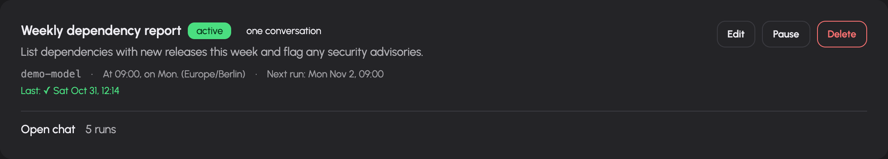
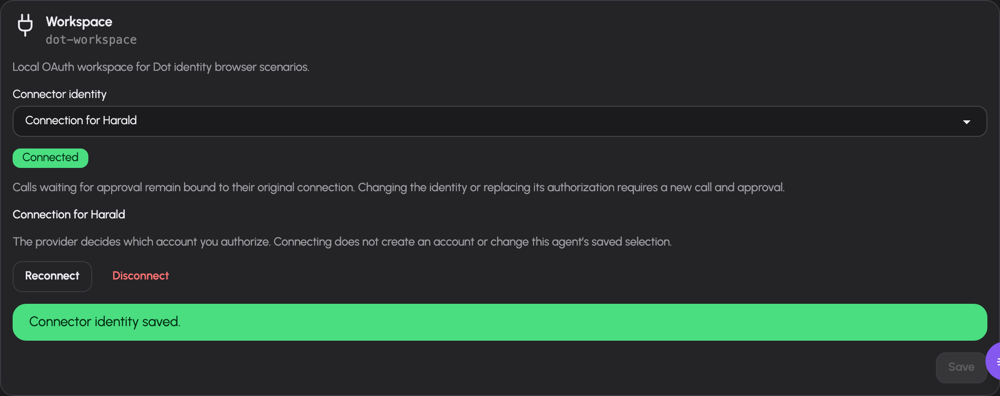
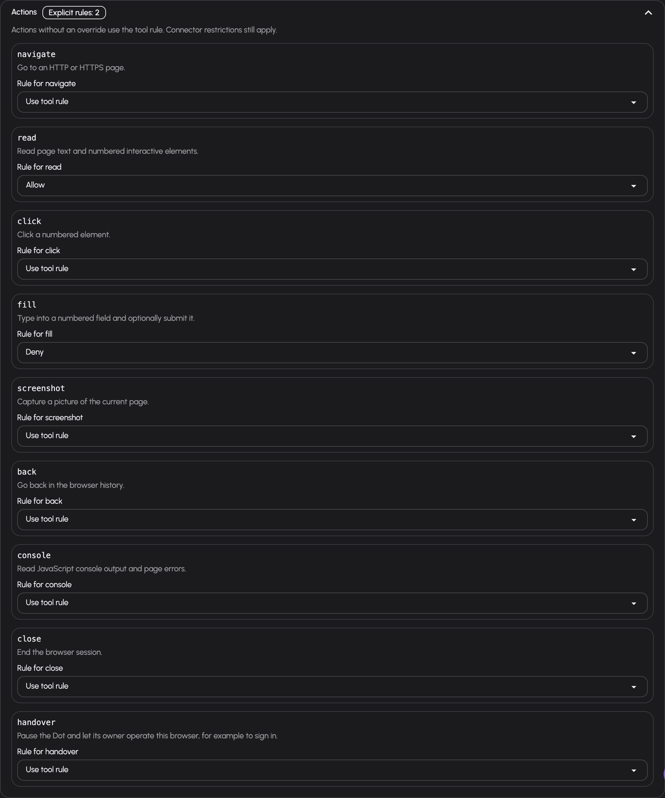
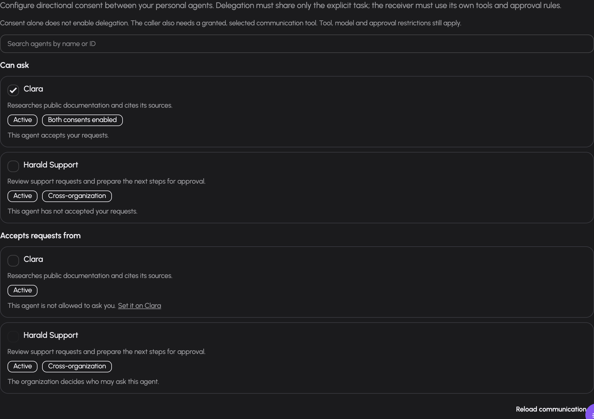
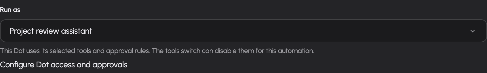

# Schedules, webhooks and inbox

Schedules run a prompt at configured times. Webhooks run a prompt when another system calls a secret trigger URL. Their results are saved as conversations and run history. Use the inbox when work needs a human decision.

## Schedule a recurring task

1. Open `/scheduled` and select the new-schedule action.
2. Enter a name, choose an available model and write the prompt. Choose **Run as** to use the ordinary assistant or an active personal Dot you own.
3. Select hourly, daily, weekly or monthly timing; use Advanced for a five-field cron expression.
4. Choose a timezone and inspect the summary and upcoming-run preview. Weekly schedules require at least one weekday.
5. Decide whether tools should be enabled for the run.
6. Decide whether runs should reuse a conversation. If enabled, choose the history window, from 1 to 50 rounds, and optionally select an existing conversation through the linked-chat picker.
7. Save, then inspect the schedule card's next-run time and active status.

The form accepts names up to 128 characters and prompts up to 8,000 characters. It displays configured GDPR and NDA metadata warnings for the selected model. Choose a model appropriate to the actual data in the prompt.

Fresh conversations keep runs independent; reusing a conversation carries the configured recent history into subsequent runs. The schedule card links to the resulting chat or run history, depending on what exists. It displays the selected Dot when bound, the latest success, waiting or failure status, and any recorded error.

Use **Pause** to prevent future scheduled runs, **Resume** to reactivate, **Edit** to change configuration, or Delete and confirm to remove the schedule. The page does not provide a manual run-now button.

## Create an event-driven webhook

1. Open `/webhooks` and select the new-webhook action.
2. Enter a name, model and prompt describing how to process the incoming event body. Choose **Run as** to use the ordinary assistant or an active personal Dot you own.
3. Choose synchronous or asynchronous execution.
4. Decide whether to enable tools. Tools are disabled by default in the new-webhook form; enabling them displays a warning because an external trigger can cause work under your account.
5. Optionally enable conversation reuse and choose its recent-history window and linked chat.
6. Save and copy the secret trigger URL from its reveal panel.
7. Configure the event source to call that URL with its payload.

The trigger URL's secret is the credential. Possession of that URL allows a caller to trigger the webhook while it is enabled. Keep it private. The prompt receives the request method, content type and body as event input. It is not a template in which you must invent payload placeholder syntax. The trigger body is capped at 256 KiB.

| Mode | HTTP behavior |
| --- | --- |
| Asynchronous | Returns HTTP 202 with `status: accepted` and a `session_id`; the run continues in the background. |
| Synchronous | Returns HTTP 200 with output on success, HTTP 202 with `status: waiting` and a session ID when a decision is needed, or HTTP 502 with a run error. |

Acceptance does not mean successful execution. Follow the recorded conversation and run status.

## Inspect and replay webhook runs

A webhook card shows active/paused state, execution mode, latest status, chat and run-history links. Run history records the payload and the prompt used for that fire. These can contain sensitive event data.

After a payload has been stored, use the rerun link to replay it with a prompt. Run history can also identify a specific older run to replay. Rerunning creates a fresh conversation with the webhook's current Dot binding and can execute tools again; use it deliberately for debugging or revised processing. A rerun that needs approval is accepted with HTTP 202 and opens the conversation; answer it in Inbox.

Use Pause or Resume to control future triggers. A paused or invalid trigger returns not-found behavior. Rotate the secret when you need a replacement trigger URL, and update the event source. Delete removes the configured webhook after confirmation.

## Answer requests in the inbox

Open `/inbox` to review pending requests visible to your account. The navigation badge updates as waiting items change. Items can include a chat or agent context and a link back to the originating work.

1. Read the request, its origin and any visitor message or supplied slots.
2. Expand transcript context when offered.
3. For approval, inspect the tool name and arguments before choosing an available decision.
4. For a requested answer or value, fill in the supplied field and submit.
5. Check that the item was settled and follow the original conversation to inspect resumed work.

The card only offers decisions the server permits. Expiry information appears when the request has an expiry. If another person already settled it or it expired, the page reports that state and refreshes; your later click does not replace the earlier decision. Sensitive-value requests can use a password field rather than a visible text area.

## Manage personal Dots

Open **Workspace → Dots** to list and create your personal Dots or change their
active state. Your administrator enables **Personal Dot manager** in your
resolved gateway group; ordinary agent management is a separate permission.
Admins hold both. The configured cap counts active Dots even when idle;
deactivating one frees a slot. Removing management permission blocks lifecycle
management, without deactivating existing Dots or stopping their runs. Tool
access and approvals remain bounded by the current permissions on execution.

## Configure a personal Dot's tool access

Open `/dots` and expand **Access and approvals** on your Dot's card. Search
by tool name, description or ID, select each tool the Dot may use, and
choose **Allow** or **Ask before each call**. Save your changes. Unselected
tools are denied. Tool IDs distinguish actions that share a capability title.
The identity label identifies the user, Dot or shared connector connection;
a connector configured to ask still asks when the Dot rule is Allow.

For a supported personal OAuth connector, use **Connector identity** to choose
**My connection** or the connection for your named Dot. **Connect** authorizes
an account at the provider; it does not create an account or select it for
execution. After returning, choose the connected identity and save it. The
provider determines the external account; AIplane does not infer an email
address from the token.

Identity changes leave your tool rules intact. Reload access to inspect the
selected connection's actual tools before saving rules. A disconnected or
replaced selected credential stays unavailable until you explicitly save an
available selection. **Disconnect** removes only that Dot's local credentials;
your personal connection remains. Pending calls retain their original
connection and generation: after a selection change or reauthorization,
request a new call and approval. Ordinary token refresh preserves the generation.

Changing the connector's server or authentication configuration also makes
previous credentials unavailable. Reload connections, reconnect the affected
account, then explicitly save the identity you want the Dot to use. Your
personal account and the Dot account reconnect separately. Returning the
connector to its previous server does not reactivate earlier credentials or
pending approvals. Display-name changes do not require reconnection.

If the connector is disabled, removed or outside your connector permissions,
**Reload connections** retains the Dot's actual local credentials under their
stored connector key. You can disconnect them with Personal Dot manager
permission, including while the Dot is inactive and when that connection was
never selected. The unavailable row offers no connection or selection action
and does not disclose the restricted connector's details or your separate
personal account. Disconnect does not revoke the account at the provider.

For `browse_page` or `browser_control`, open **Actions** under the selected tool. Choose **Use tool
rule**, **Allow**, **Ask**, or **Deny** for each action. For example, keep the tool
on Ask, allow `read` and deny `fill`. Save and reload to review the stored rules.
A denied action does not execute, including on an earlier pending approval.
Browser action lists are checked in full: any Deny prevents the whole batch;
otherwise any Ask requests approval once for that batch. `browser_control`
still requires your connected browser extension and its own confirmations.
Connector restrictions still apply. Other tools show action controls only when
their implementation supplies a catalogue. If a saved action is unavailable,
remove its rule before saving; the interface preserves it for review.

New Dots select the existing memory tools when available to your account.
Memory writes belong to that Dot; user-wide memory remains read-only context.
Read-only tools default to Allow when you select them. Writes and tools with
unknown effects default to Ask before each call; you can adjust their rule
within your existing rights.

An approval request pauses the Dot chat and appears in chat and Inbox. Approve
once permits only that call's recorded arguments. Current permissions and Dot
availability are checked again before execution; removing a selected tool or
disabling it in your account prevents a pending approval from running it.
Deactivating a Dot retains its data and conversations and cancels its active
personal runs and linked delegation work. Organization Dots support member
configuration, their own connected identities, private draft or published conversations and
scoped memory. See [Organization Dots](../dots-organizations.md) for their
current access requirements. Organization automation, automatic memory curation
and persistent Dot computers are not available.

## Configure communication consent

Expand **Communication** on a Dot card. **Can ask** controls its outgoing
consent to each actual owned peer. **Accepts requests from** controls which
peers it accepts requests from. The counterpart choice is read-only; configure
it on the other Dot's card. Save each changed row separately. **Both consents
enabled** means both persisted choices allow that direction. Reverse
communication needs separate choices.

Inactive peers stay visible. Enabling requires both Dots active, and revocation
is available while inactive. A stale save keeps your draft and reports a
conflict; use **Reload communication** to fetch current choices. Changing
consent requires current Personal Dot manager permission. To delegate, select
the existing forwarding tool in the sending Dot's access rules. The receiving
Dot uses its own selected tools, current permissions and memory. Both consents
are checked before dispatch; reverse requests require their own consent.
Approvals return to your existing Inbox and originating chat. See
[Dot communication](../dots-communication.md).

## Run scheduled or event-driven work as a Dot

An active Dot card has **Add scheduled work** and **Add webhook** links to the existing
creation forms with that Dot selected. You can also choose it in **Run as**
when creating or editing an automation. The available model, timing, tools,
mode and conversation settings remain those of the existing form.

A reused conversation must be private, owned by you and bound to the same
Dot. The linked-chat picker shows matching conversations only. Changing
**Run as** clears your linked-chat selection. Choose a new matching chat or
start fresh. Ordinary automations cannot reuse a Dot conversation.

Enabling tools does not approve them. Dot access rules, connector rules and
your current grants still apply. A turn that started with tools disabled keeps
that restriction after resumption, even if you enable tools later. The run
also retains its original history window when it resumes.

**Waiting** means the run needs a decision. Use its Inbox link or open the
conversation, inspect the actual tool and arguments, and approve once or deny.
Current permissions are checked again. Once settled, inspect the conversation
and run history for the outcome. The conversation's normal stop control can
stop background work through the same worker registry as chat.

Pausing an automation prevents future triggers; it does not discard an
existing pending decision. Deactivating its Dot keeps ordinary pending Dot
calls paused and preserves conversations. Affected delegation trees are
cancelled when a participating Dot is deactivated or effective consent changes. An inactive or unavailable existing Dot
binding remains shown when editing; you may save unrelated changes, reactivate
the Dot or choose another active assistant. New bindings require an active
Dot you own.

An automation with a running or waiting turn cannot be deleted. Pause it,
finish or stop its pending turn, then delete it. The Dot limit counts active
Dots, including idle ones; it does not count their scheduled runs. Usage and
limits remain attached to your account rather than a separate Dot budget.

## Troubleshooting

- **No upcoming schedule run:** inspect the cron expression, selected weekdays and timezone preview.
- **Run fails:** inspect the recorded error and conversation. Model grants, upstream health, tools and owner limits can affect execution.
- **Webhook returns accepted but there is no useful output:** inspect run history; HTTP 202 only acknowledges acceptance.
- **Webhook returns not found:** verify the current secret URL and active state.
- **A run waits for a decision:** check the inbox or linked conversation and answer the pending request.
